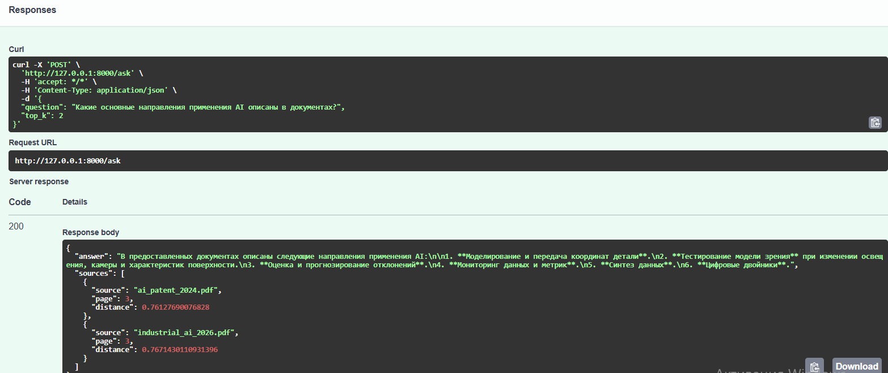
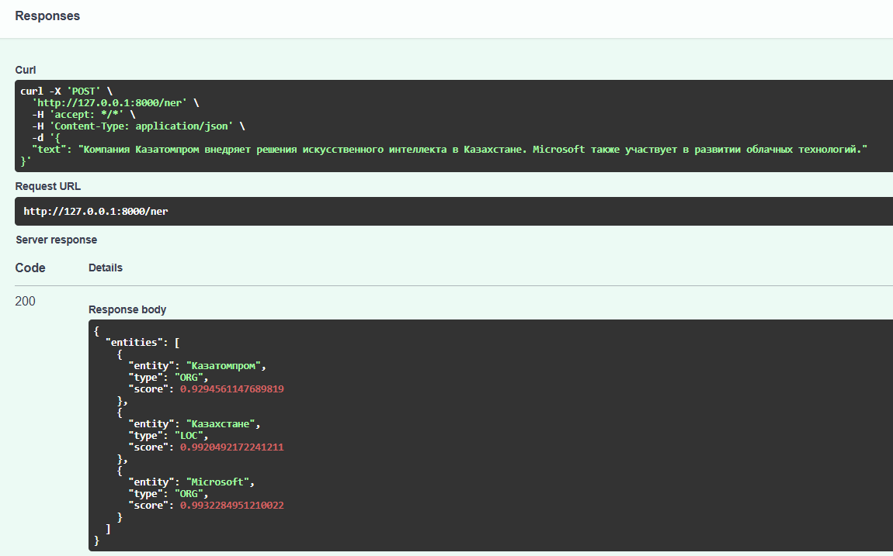
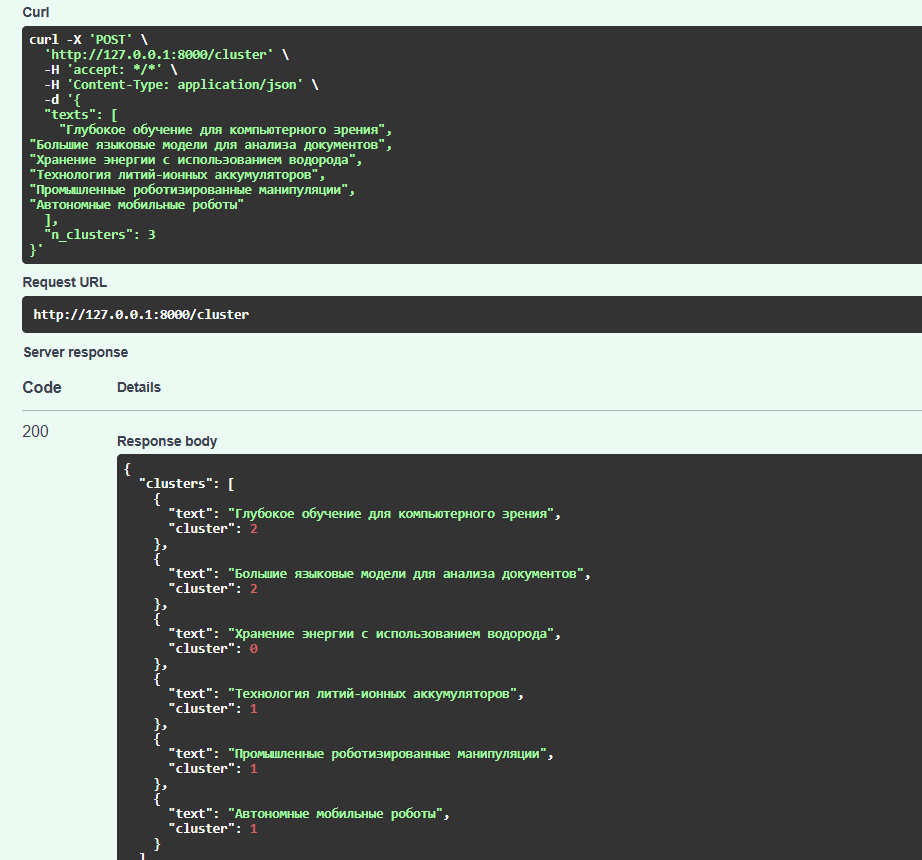
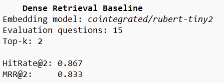

# Local Scientific Intelligence Assistant

Локальная система для анализа научных статей, технических отчётов и других документов с использованием RAG, локальной языковой модели и методов обработки естественного языка.

Проект работает без внешних LLM API: генерация ответов выполняется локально через Ollama.

## Основные возможности

Система позволяет:

- загружать и обрабатывать PDF-документы;
- разбивать документы на текстовые фрагменты;
- создавать векторные представления текста;
- выполнять семантический поиск по документам;
- формировать ответы только на основе найденного контекста;
- показывать источник и страницу документа;
- извлекать именованные сущности;
- классифицировать текст по тематике;
- группировать документы по смысловой близости;
- извлекать отношения между сущностями;
- анализировать изменение тематик во времени;
- выявлять потенциальные растущие направления;
- оценивать качество поиска с помощью `HitRate@K` и `MRR`.

---

## Используемые технологии

- Python 3.11
- FastAPI
- Ollama
- Qwen3
- Hugging Face Transformers
- Sentence Transformers
- PyTorch
- ChromaDB
- PyMuPDF
- scikit-learn
- pandas
- Docker
- Docker Compose

---

## Архитектура

```text
PDF-документы
      │
      ▼
   PyMuPDF
      │
      ▼
Разбиение текста
на фрагменты
      │
      ▼
Hugging Face
Embeddings
      │
      ▼
   ChromaDB
      │
      ▼
Семантический поиск
      │
      ▼
Найденный контекст
      │
      ▼
Ollama + Qwen3
      │
      ▼
Ответ со ссылками
на документы и страницы
```

Дополнительный анализ текста:

```text
Документ
   │
   ├── NER
   │     └── организации, люди, локации
   │
   ├── Классификация
   │     └── AI, робототехника, энергетика и др.
   │
   ├── Кластеризация
   │     └── автоматическое объединение похожих текстов
   │
   ├── Извлечение отношений
   │     └── сущность → отношение → сущность
   │
   └── Анализ тематик
         └── растущие направления и слабые сигналы
```

---

## Структура проекта

```text
local-scientific-intelligence/
│
├── app/
│   ├── config.py
│   ├── pdf_loader.py
│   ├── embeddings.py
│   ├── vector_store.py
│   ├── rag.py
│   ├── nlp.py
│   ├── topics.py
│   ├── relations.py
│   ├── schemas.py
│   └── main.py
│
├── scripts/
│   ├── ingest.py
│   └── analyze_trends.py
│
├── evaluation/
│   ├── questions.json
│   └── evaluate_retrieval.py
│
├── tests/
│   └── test_api.py
│
├── data/
│   ├── raw/
│   ├── chroma/
│   └── metadata.csv
│
├── images/
│   ├── ask_post.png
│   ├── cluster.png
│   ├── eval_result.png
│   └── ner.png
│
├── Dockerfile
├── docker-compose.yml
├── requirements.txt
├── .gitignore
└── README.md
```

---

# RAG

Основная часть проекта построена по схеме:

```text
Вопрос пользователя
        │
        ▼
Векторное представление вопроса
        │
        ▼
Поиск в ChromaDB
        │
        ▼
Наиболее релевантные фрагменты
        │
        ▼
Локальная модель Qwen3
        │
        ▼
Ответ на основе найденного контекста
```

Языковая модель не выполняет поиск по документам самостоятельно.

Поиск выполняется отдельно через векторную базу данных, после чего найденные фрагменты передаются модели как контекст.

Для каждого найденного фрагмента сохраняются метаданные:

- имя файла;
- страница;
- название документа;
- дата;
- тип документа.

Благодаря этому система может указывать источник информации в ответе.

---

## Пример запроса

Для работы с системой используется REST API на FastAPI.

Основной метод:

```text
POST /ask
```

Пример запроса:

```json
{
  "question": "Какие технологии используются для промышленного искусственного интеллекта?",
  "top_k": 4
}
```

Система:

1. преобразует вопрос в векторное представление;
2. ищет наиболее близкие фрагменты документов;
3. выбирает `top_k` результатов;
4. передаёт их локальной языковой модели;
5. получает ответ;
6. возвращает ответ вместе с источниками.

### Пример работы `/ask`



---

# Локальная языковая модель

В проекте используется Ollama.

Модель:

```text
Qwen3
```

Языковая модель запускается локально и не требует использования:

- OpenAI API;
- Anthropic API;
- Groq API;
- других внешних LLM API.

Это позволяет использовать систему в закрытом контуре, где документы не должны передаваться внешним сервисам.

---

# Векторный поиск

Для хранения векторных представлений используется ChromaDB.

Векторные представления создаются с помощью модели Hugging Face.

Пример модели:

```text
cointegrated/rubert-tiny2
```

Для более мощной конфигурации могут использоваться:

```text
intfloat/multilingual-e5-base
```

или:

```text
BAAI/bge-m3
```

После обработки PDF каждый документ разбивается на небольшие фрагменты.

Пример:

```text
industrial_ai_2026_p1_c0
industrial_ai_2026_p1_c1
industrial_ai_2026_p2_c0
...
```

Каждый фрагмент сохраняется в ChromaDB вместе с метаданными.

---

# Извлечение именованных сущностей

Для извлечения сущностей используется модель Hugging Face Transformers.

Система может определять:

- организации;
- людей;
- страны и города;
- другие именованные сущности.

Пример текста:

```text
Компания Казатомпром внедряет решения искусственного интеллекта
в Казахстане совместно с технологическими партнёрами.
```

Результат может содержать:

```json
[
  {
    "entity": "Казатомпром",
    "type": "ORG"
  },
  {
    "entity": "Казахстан",
    "type": "LOC"
  }
]
```

### Пример работы NER



---

# Классификация текста

Для определения тематики используется сравнение векторного представления текста с векторными представлениями заранее заданных категорий.

Примеры категорий:

```text
искусственный интеллект
робототехника
энергетика
материалы
биотехнологии
телекоммуникации
кибербезопасность
```

Пример:

```text
Deep learning neural network for image classification
```

может быть классифицирован как:

```json
{
  "label": "artificial_intelligence",
  "score": 0.74
}
```

---

# Кластеризация документов

В отличие от классификации, при кластеризации категории заранее не задаются.

Процесс:

```text
Тексты
   │
   ▼
Векторные представления
   │
   ▼
KMeans
   │
   ▼
Группы похожих документов
```

Например:

```text
Deep learning for computer vision
LLM for document analysis
Hydrogen energy storage
Lithium ion battery technology
Industrial robotic manipulation
Autonomous mobile robots
```

могут автоматически разделиться на группы:

```text
кластер 0 → AI
кластер 1 → энергетика
кластер 2 → робототехника
```

### Пример кластеризации



---

# Извлечение отношений

Локальная языковая модель используется также для извлечения отношений между сущностями.

Например из текста:

```text
Казатомпром внедрил систему компьютерного зрения
на производственной площадке в Казахстане.
```

можно получить:

```json
[
  {
    "subject": "Казатомпром",
    "relation": "внедрил",
    "object": "система компьютерного зрения"
  }
]
```

Модель получает инструкцию использовать только информацию, присутствующую в исходном тексте.

---

# Анализ тематик

Документы содержат метаданные с датой публикации.

Это позволяет подсчитать распространённость тем по годам.

Например:

```text
2024

artificial_intelligence: 2
energy: 5
robotics: 1

2025

artificial_intelligence: 5
energy: 7
robotics: 3

2026

artificial_intelligence: 11
energy: 6
robotics: 8
```

На основе изменения количества документов можно находить быстрорастущие направления.

---

# Слабые сигналы

В проекте реализован простой базовый подход к выявлению потенциальных слабых сигналов.

Идея:

```text
небольшое количество документов
             +
быстрый относительный рост
             =
потенциально растущая тематика
```

Например:

```text
2025 → 1 документ
2026 → 4 документа
```

может быть отмечено как быстрорастущее направление.

Это не полноценная исследовательская модель прогнозирования, а объяснимый базовый алгоритм для демонстрации подхода.

---

# Оценка качества поиска

Для оценки RAG недостаточно проверить, что языковая модель формирует красивый ответ.

Сначала необходимо проверить качество поиска.

В проекте используются:

### HitRate@K

Показывает, оказался ли правильный документ среди первых `K` найденных результатов.

### MRR

`Mean Reciprocal Rank` учитывает позицию правильного документа.

Если нужный источник найден первым:

```text
1 / 1 = 1.0
```

Если вторым:

```text
1 / 2 = 0.5
```

Если четвёртым:

```text
1 / 4 = 0.25
```

Для оценки используется набор контрольных вопросов:

```json
[
  {
    "question": "Какие методы компьютерного зрения используются в промышленности?",
    "expected_source": "industrial_ai_2026.pdf"
  },
  {
    "question": "Какие технологии рассматриваются для хранения энергии?",
    "expected_source": "energy_storage_2025.pdf"
  }
]
```

### Результат оценки



Также система тестируется вопросами, ответа на которые нет в базе документов.

В таком случае ожидается отказ от генерации неподтверждённого ответа.

Пример:

```text
В предоставленных документах недостаточно информации для ответа.
```

Это позволяет дополнительно проверять устойчивость системы к галлюцинациям.

---

# API

После запуска доступны следующие методы:

| Метод | Назначение |
|---|---|
| `GET /health` | Проверка состояния сервиса |
| `POST /ask` | RAG-вопрос по документам |
| `POST /ner` | Извлечение сущностей |
| `POST /classify` | Определение тематики |
| `POST /cluster` | Кластеризация текстов |
| `POST /relations` | Извлечение отношений |

Документация FastAPI доступна по адресу:

```text
http://localhost:8000/docs
```

---

# Установка

## 1. Клонирование проекта

```bash
git clone <адрес-репозитория>
cd local-scientific-intelligence
```

---

## 2. Создание виртуального окружения

Windows:

```powershell
py -3.11 -m venv .venv
```

Активация:

```powershell
.\.venv\Scripts\Activate.ps1
```

---

## 3. Установка зависимостей

```powershell
pip install -r requirements.txt
```

---

# Добавление документов

PDF-файлы необходимо поместить в:

```text
data/raw/
```

Метаданные документов задаются в:

```text
data/metadata.csv
```

Пример:

```csv
filename,title,date,document_type
ai_report_2024.pdf,Artificial Intelligence Report,2024-03-10,report
robotics_report_2025.pdf,Industrial Robotics,2025-02-14,report
energy_storage_2025.pdf,Energy Storage Market,2025-08-10,report
```

---

# Индексация документов

Для обработки PDF и загрузки данных в ChromaDB:

```powershell
python -m scripts.ingest
```

Во время выполнения:

```text
PDF
 ↓
извлечение текста
 ↓
разбиение на фрагменты
 ↓
создание embeddings
 ↓
загрузка в ChromaDB
```

---

# Запуск без Docker

Сначала необходимо запустить Ollama и убедиться, что модель установлена.

Например:

```powershell
ollama pull qwen3:0.6b
```

Проверка:

```powershell
ollama list
```

После этого запускается FastAPI:

```powershell
uvicorn app.main:app --reload
```

API будет доступен:

```text
http://localhost:8000
```

Swagger:

```text
http://localhost:8000/docs
```

---

# Запуск через Docker

Запуск Ollama:

```powershell
docker compose up -d ollama
```

Загрузка модели внутрь контейнера:

```powershell
docker compose exec ollama ollama pull qwen3:0.6b
```

Проверка:

```powershell
docker compose exec ollama ollama list
```

После этого запуск всей системы:

```powershell
docker compose up -d --build
```

Проверка контейнеров:

```powershell
docker compose ps
```

После запуска API доступен по адресу:

```text
http://localhost:8000/docs
```

---

# Анализ тематик

Для анализа изменения тематик:

```powershell
python -m scripts.analyze_trends
```

Пример результата:

```text
TOPIC COUNTS

2024
  artificial_intelligence: 2
  energy: 4

2025
  artificial_intelligence: 5
  energy: 6

2026
  artificial_intelligence: 9
  robotics: 5
```

---

# Оценка поиска

Запуск:

```powershell
python -m evaluation.evaluate_retrieval
```

Пример:

```text
HitRate@4: 0.900
MRR@4: 0.825
```

---

# Тесты

Запуск автоматических тестов:

```powershell
pytest -v
```

Проверяются, в частности:

- доступность API;
- корректность основных методов;
- классификация текста.

---

# Особенности проекта

Ключевая особенность системы — отсутствие внешних LLM API.

```text
Пользователь
     │
     ▼
FastAPI
     │
     ├────────► ChromaDB
     │
     ▼
   Ollama
     │
     ▼
   Qwen3
```

Документы, запросы и найденный контекст могут обрабатываться полностью локально.

Такой подход подходит для систем, где важны:

- конфиденциальность данных;
- закрытый контур;
- техническая и научная документация;
- внутренние корпоративные документы;
- отсутствие зависимости от внешних LLM-сервисов.

---

# Ограничения

- используется небольшая локальная модель;
- качество зависит от возможностей компьютера;
- классификация основана на сходстве векторных представлений;
- алгоритм слабых сигналов является базовым;
- нет отдельного интерфейса пользователя;
- нет  системы авторизации;

---

# Возможные улучшения

В дальнейшем проект можно расширить:

- заменить небольшую Qwen3 на более мощную модель;
- использовать `multilingual-e5-base` или `BGE-M3`;
- добавить гибридный поиск `BM25 + Dense Retrieval`;
- добавить `RRF`;
- добавить reranker;
- улучшить оценку качества генерации;
- добавить автоматическую проверку цитат;
- добавить обнаружение аномалий;
- реализовать более сложный анализ трендов;
- использовать vLLM для серверного запуска модели;
- добавить веб-интерфейс;
- добавить авторизацию и разграничение доступа.

---

# Цель проекта

Проект создан как практическая реализация локальной системы анализа научной и технической информации и демонстрирует работу с:

```text
Local LLM
RAG
Semantic Search
Hugging Face
PyTorch
NER
Classification
Clustering
Relation Extraction
Trend Analysis
FastAPI
Docker
Evaluation
```

Основной акцент сделан на локальную обработку данных, проверяемые ответы по источникам и объединение RAG с классическими задачами NLP.